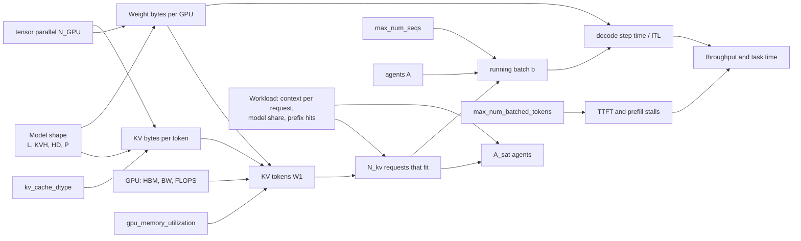

# Parameter relationships: master sheet

How the model, the hardware, the vLLM knobs and the workload connect. Equations are approximate (first-order),
meant for intuition and loose bounds, not exact prediction. "Yours" values come from runs `20261026_200252` and
`20261026_201733` (concurrency 1, TP=2, bf16 KV). Chapter numbers point to `ranges_worksheet.ipynb`.



---

## 0. Symbols and your values

| Symbol | Meaning | Yours |
|---|---|---|
| L | layers | 64 |
| QH, KVH | query heads, KV heads (GQA) | 64, 8 |
| HD | head dim | 128 |
| H, I, V | hidden, MLP intermediate, vocab | 5120, 26624, 250624 |
| P | parameters | ~34.8 B |
| s_w | bytes per weight (bf16) | 2 |
| s_kv | bytes per KV element (`auto`=bf16 → 2, fp8 → 1) | 2 |
| N_GPU | tensor-parallel GPUs | 2 |
| HBM | memory per GPU, as vLLM sees it | ~79.2 GiB (H100 80GB; check boot log) |
| BW | peak HBM bandwidth per GPU | 3.35 TB/s |
| F | peak bf16 compute per GPU | 989 TFLOP/s |
| η_bw, η_c | fraction of peak bandwidth / compute actually achieved | η_bw ≈ 0.69 (Ch 7); η_c from Ch 2 |
| u | `gpu_memory_utilization` | 0.90 |
| B | `max_num_batched_tokens` | 8192 |
| S | `max_num_seqs` | 135 (stale) |
| ctx | KV tokens one request holds (prompt + generated so far) | mean ≈ 8.35k, p90 ≈ 13.6k, max ≈ 34.9k |
| h | prefix-cache hit rate | ~28% |
| share | fraction of an agent's time spent in model calls | 0.92 |
| A | concurrent agents (the sweep variable) | 1 → 128 |
| b | sequences in the running decode batch | |

---

## 1. Model shape → bytes

```
weight bytes (total)        = s_w × P                          = 2 × 34.8e9 ≈ 69.6 GB  (64.8 GiB)
weight bytes per GPU        = s_w × P / N_GPU                  ≈ 34.8 GB  (32.4 GiB)

KV bytes per token (total)  = 2 × L × KVH × HD × s_kv          = 2·64·8·128·2 = 262,144 B (256 KiB)
KV bytes per token per GPU  = KV bytes per token / N_GPU       = 131,072 B   (valid while N_GPU ≤ KVH)
```

- The leading 2 counts K and V. Uses KVH, **not** QH or H: GQA makes the cache 8× smaller than full multi-head attention.
- `kv_cache_dtype=fp8` → s_kv = 1 → KV bytes per token halves.
- More GPUs (N_GPU ↑) shrink both per-GPU numbers by the same factor.

Parameter count, if you need to rebuild P:

```
per layer   = attention (H·QH·HD + 2·H·KVH·HD + QH·HD·H)  +  MLP (3·H·I)  ≈ 94.4M + 408.9M
P           ≈ L × per layer  +  2·V·H (untied embeddings)  ≈ 32.2B + 2.6B ≈ 34.8B
```

---

## 2. Memory budget → KV tokens (W1)

```
KV memory per GPU  = u × HBM  −  weight bytes per GPU  −  overhead (activations, CUDA graphs, buffers)
W1 (KV tokens)     = KV memory per GPU / KV bytes per token per GPU
```

Yours: 0.90 × 79.2 − 32.4 − overhead = 36.6 GiB → overhead ≈ 2.3 GiB; 36.6 GiB / 128 KiB ≈ **299,952 tokens** (the
server reports W1 directly in `cache_config_info`).

Sensitivities (per GPU, your setup):

```
Δu = +0.01   →  +0.79 GiB  →  +~6.5k tokens  →  +~0.8 mean-sized requests
fp8 KV       →  W1 × 2     ≈  600k tokens
N_GPU 2 → 4  →  weights/GPU halve (frees ~16 GiB/GPU) AND KV bytes/token/GPU halve  →  W1 ≈ 2.5–3×
```

Constraint: `max_model_len` ≥ longest prompt + `max_tokens` (yours: 64,000 ≥ ~35k + 4,096), and one max-length
request must fit in W1. `max_model_len` sets a limit; it does not use memory.

---

## 3. KV tokens → requests that fit (N_kv)

```
KV per request (tokens)  ≈ ctx + block/2          (blocks are 16 tokens; on average half a block is wasted)
N_kv                     ≈ W1 / KV per request
```

| Request size | N_kv |
|---|---|
| mean | ~35.9 |
| p90 | ~22.1 |
| max | ~8.6 |

- Prefix caching lets requests share identical leading blocks, so real capacity ≥ N_kv. Treat N_kv as conservative.
- This is a count of **requests (sequences)**, not agents.

---

## 4. Agents ↔ requests (closed loop)

Each agent has at most one model request in flight. It is either in a model call (share) or in a tool call (1 − share).

```
requests in flight (demand)  ≈ A × share
A_sat                        ≈ N_kv / share          (agents at which KV fills)
```

Yours: A_sat ≈ 39 (mean), 24 (p90), 9 (max).

Task time and throughput (Little's law: number in system = throughput × time in system):

```
T_task  = Σ over calls (T_queue + TTFT + out_tokens × ITL)  +  Σ over searches T_search
X       = A / T_task                                         (tasks per second)
tasks per GPU-hour = 3600 × X / N_GPU
```

- Below A_sat: T_task rises slowly (ITL creeps up, see §6), X ≈ proportional to A.
- Above A_sat: X plateaus at X_max; extra agents only queue, so T_task ≈ A / X_max (grows linearly).

---

## 5. The running batch and `max_num_seqs`

```
b  ≈  min( A × share,  S,  what fits in KV right now )
```

- **S < N_kv**: KV partly idle, requests queue at the S cap. Safe, but throughput is left unused.
- **S ≈ N_kv**: matched to the average request.
- **S > N_kv**: packs more in when requests are short; when they grow and blocks run out, **preemption** (KV dropped
  and recomputed later, which wastes prefill compute).

Sweep: S ≈ {0.5, 1, 2} × N_kv ≈ {18, 36, 72}. Watch preemptions, KV usage and p90 task time.

---

## 6. Decode step time (ITL) and throughput

Each decode step reads all the weights once (shared by the batch) plus every sequence's own KV:

```
bytes per GPU per step  ≈  weight bytes per GPU  +  b × ctx × KV bytes per token per GPU
t_step (decode only)    ≈  bytes per GPU per step / (η_bw × BW)
ITL                     ≈  t_step  (+ any prefill chunk sharing the step, §7)
decode throughput       ≈  b / t_step   tokens/s
```

| b | bytes/GPU | t_step (η_bw = 0.69) | tokens/s |
|---|---|---|---|
| 1 | 34.8 + 1.1 ≈ 35.9 GB | ~15.5 ms (measured 15.43) | ~65 |
| 36 | 34.8 + 39.4 ≈ 74.2 GB | ~32 ms | ~1,100 |

- Each extra mean-sized sequence adds ~1.1 GB/GPU (~3% of the weights) to every step.
- fp8 KV halves the per-sequence term. N_GPU ↑ shrinks both terms.
- Implied bandwidth from measurement: `η_bw × BW = bytes per step / measured ITL`.

---

## 7. Prefill, TTFT and `max_num_batched_tokens`

```
new prefill tokens   = prompt × (1 − h)                               (cached prefix blocks are skipped)
prefill FLOPs        ≈ 2 × P × tokens  +  attention term (grows with ctx)
t_prefill            ≈ prefill FLOPs / (N_GPU × η_c × F)
chunks               = ceil(new prefill tokens / B)
TTFT                 ≈ T_queue + chunks × t_chunk
```

Example (attention term ignored): one full 8192-token chunk ≈ 2 · 34.8e9 · 8192 / (2 · 989e12 · η_c) ≈ 0.29 s / η_c.
Get η_c from your measured prefill speed in Ch 2.

Per-step token budget (chunked prefill):

```
decode tokens (b, one per sequence)  +  prefill tokens this step  ≤  B
```

- **B ↑**: fewer, bigger chunks → lower TTFT for long agent prompts, but each step with a chunk takes longer, so every
  decoding sequence stalls longer (ITL spikes).
- **B ↓**: smoother ITL, longer TTFT.
- B must be ≥ S (one decode token per running sequence) and, in practice, comparable to a typical prompt increment (Ch 6).

Sweep: B ∈ {2k, 4k, 8k, 16k}.

---

## 8. Arithmetic intensity (roofline)

```
ridge = F / BW = 989e12 / 3.35e12 ≈ 295 FLOPs/byte      (below: memory-bound; above: compute-bound)

weights alone, batch b      ≈ 2P·b / 2P            = b
decode attention            = 4·L·QH·HD / KV bytes per token   = 2.1M / 262,144 = 8 × (2 / s_kv)  →  8 (bf16), 16 (fp8)
decode, combined            I(b) = (2P·b + 4·L·QH·HD·ctx·b) / (2P + b·ctx·KV bytes per token)
prefill, chunk of B tokens  ≈ B   (one weight read serves B tokens)
```

| Case | FLOPs/byte |
|---|---|
| decode b = 1 | ~1.2 |
| decode b = 36 (KV full) | ~21 |
| decode b → ∞ at ctx ≈ 8.35k | ~40 (ceiling set by attention) |
| prefill 8192-token chunk | thousands → compute-bound |

- Splitting across GPUs does not change intensity (FLOPs and bytes both divide by N_GPU).
- Decode attention intensity = QH / KVH (the GQA ratio), independent of batch. Long contexts pull decode toward it.
- Toward compute-bound: bigger batches of **short** contexts, fp8 KV, speculative decoding, prefill.

---

## 9. Knob → effect summary

| Knob | Directly changes | Downstream | Watch in sweep |
|---|---|---|---|
| `gpu_memory_utilization` u | KV memory (§2) | W1, N_kv, A_sat | OOM at boot or under load |
| `kv_cache_dtype` | s_kv (§1) | W1 ×2, per-seq decode bytes ÷2, attention intensity ×2 | accuracy / task success |
| `max_num_seqs` S | cap on b (§5) | throughput vs preemption | preemptions, KV usage, p90 |
| `max_num_batched_tokens` B | prefill chunk size (§7) | TTFT vs ITL spikes | TTFT p90, ITL p90 |
| tensor parallel N_GPU | weights and KV per GPU (§1) | W1 ↑, cost ↑, all-reduce ↑ | tasks per GPU-hour |
| `max_model_len` | longest allowed request | nothing else (fixed) | rejected requests |
| agents A | demand A × share (§4) | b, queueing, T_task | the knee near A_sat |
